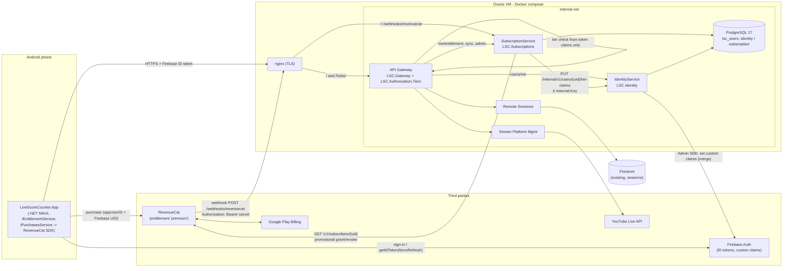
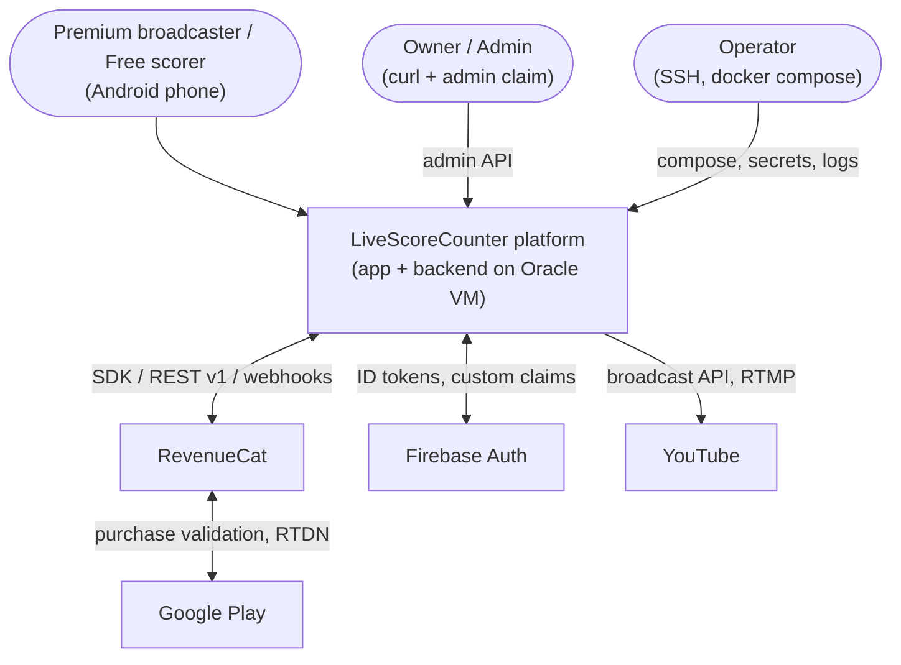
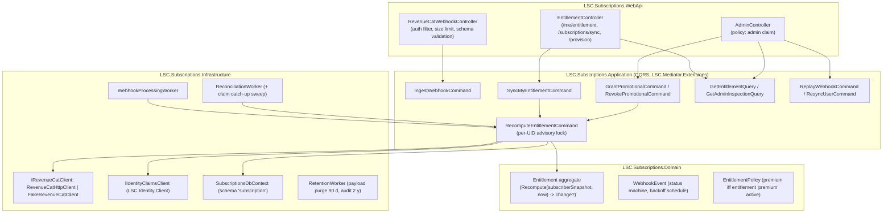
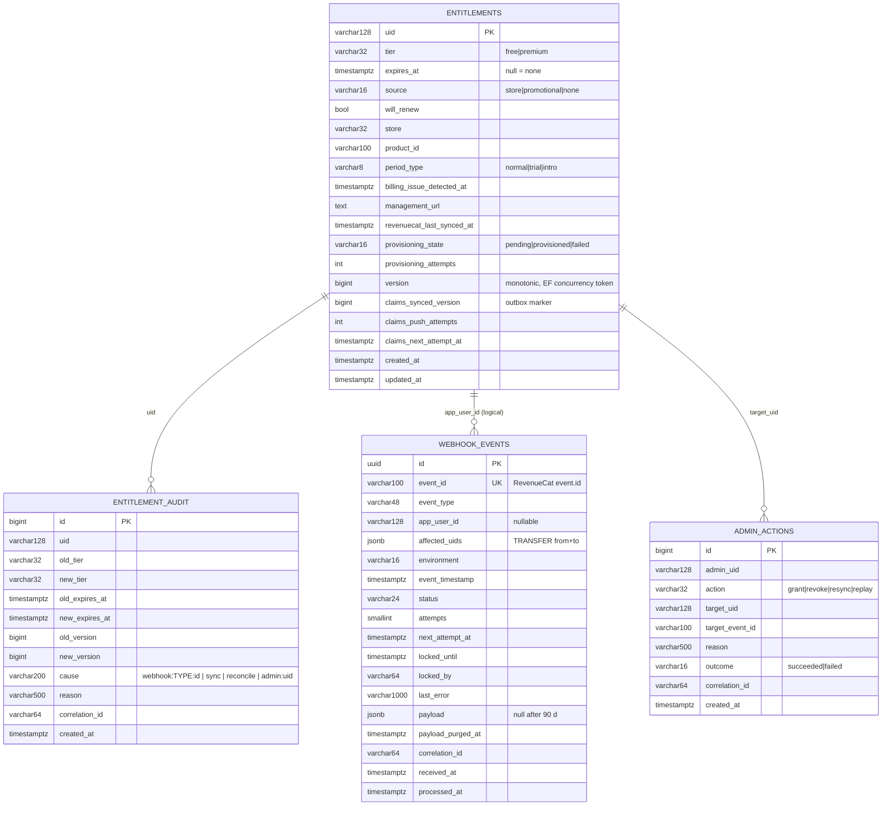
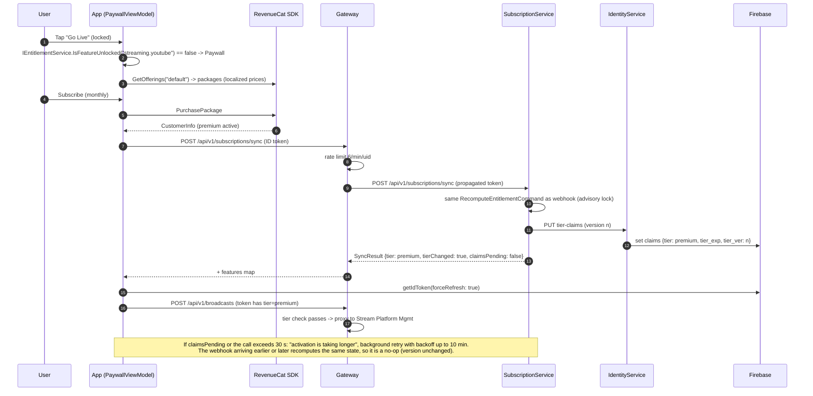
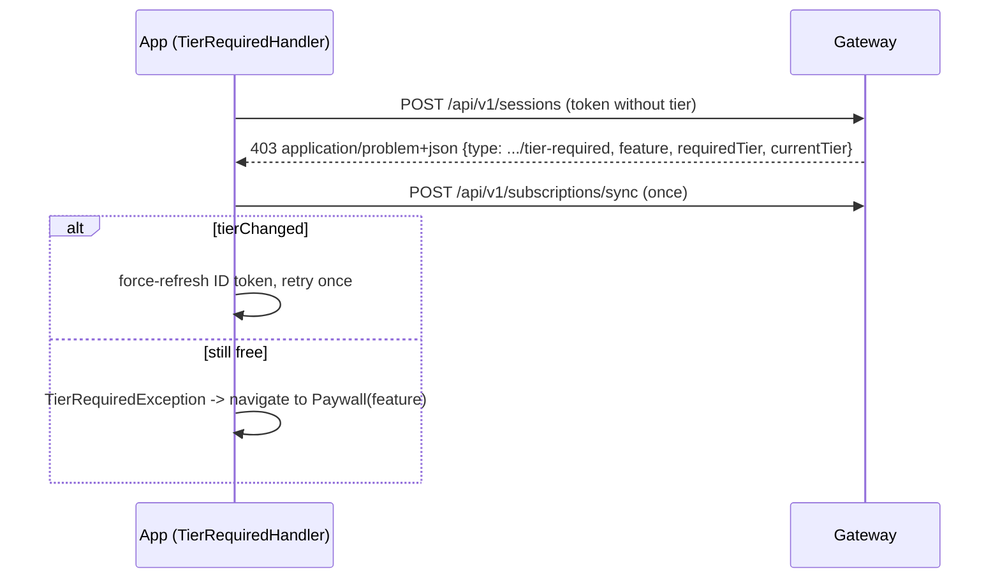
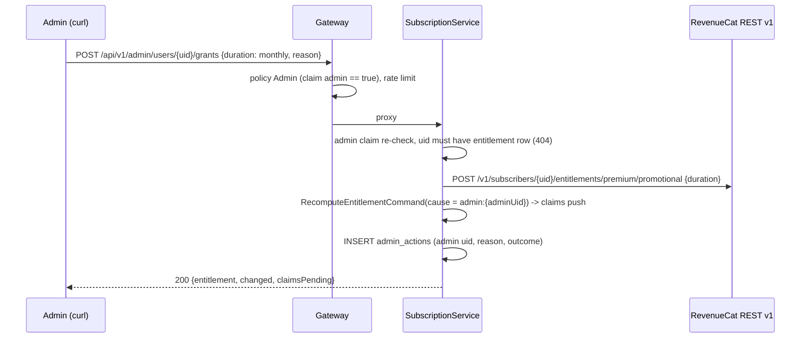
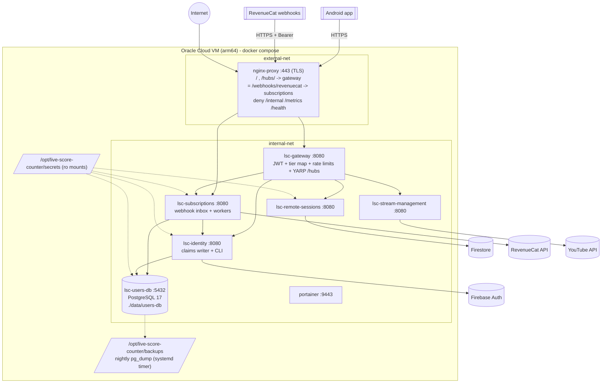

# Architecture Blueprint: LiveScoreCounter Premium / Free Tiers

| Field | Value |
|---|---|
| PRD | [`docs/prd/premium-tiers.md`](../prd/premium-tiers.md) v1.1 (authoritative for product decisions D1-D16) |
| Tracking | Issue SirLecram/ai.engineering-corp#2, branch `feat/2-premium-tier-specs` |
| Mode | AUTONOMOUS. No owner interview was possible. Every architectural decision is recorded as `AD-xx` in section 2, and assumptions are in section 18. |
| Status | **FROZEN v1.0** for task partitioning. Any change requires a revision of this file and of `docs/contracts/`. |
| Client scope | Android phone app only (PRD D16). The Gateway tier check is client-agnostic and applies to every client that calls the Gateway. |
| Contracts | [`lsc-common.openapi.yaml`](../contracts/lsc-common.openapi.yaml), [`identity-service.openapi.yaml`](../contracts/identity-service.openapi.yaml), [`subscription-service.openapi.yaml`](../contracts/subscription-service.openapi.yaml), [`gateway-premium-tiers.openapi.yaml`](../contracts/gateway-premium-tiers.openapi.yaml), [`feature-tier-map.schema.json`](../contracts/feature-tier-map.schema.json) |

---

## 0. Reference-repo findings that shape this design

These are facts from the read-only clones in `C:\Users\FWTG48\lsc-refs\LiveScoreCounter.{App,Api,Broadcast,DevOps,Libraries}`. Each one changes or confirms something in the PRD.

| # | Finding | Source | Consequence |
|---|---|---|---|
| F1 | **Today the app's scoreboard is backed by the server.** `BroadcastCameraViewModel.InitializeAsync` sends `InitializeMatchCommand`, which calls `ISessionService.InitializeSessionAsync` (`POST /api/v1/sessions`). Every increment, decrement and reset goes through `ScoreboardService` to the Remote Sessions API. There is no local-only scoring path. | App `UI.Core/ViewModels/Broadcast/BroadcastCameraViewModel.cs`, `Application/.../InitializeMatchCommandHandler.cs`, `UI.Core/Services/ScoreboardService.cs` | Gating `POST /api/v1/sessions` (`sessions.remote.host` = premium) would **break scoring for free users**. A new **local scoring mode** in the app is mandatory and is the first work item to start (APP-1). Enforcement rollout is staged (AD-14). |
| F2 | nginx routes `/` and `/hubs/` only to the Gateway. Remote Sessions and Stream Platform Mgmt are reachable only on `internal-net` and have **no authentication of their own** (`LSC.RemoteSessions` has no `UseAuthentication`). | DevOps `infrastructure/docker/nginx/gateway.conf`, `docker-compose.yml`; Broadcast `LSC.RemoteSessions/Program.cs` | PRD **A2 confirmed**. The Gateway is the single enforcement point (D4). **No code change is required in `LiveScoreCounter.Broadcast`** (AD-11). |
| F3 | The Gateway is ASP.NET Core on .NET 10. It uses controllers, MediatR (`ICommand`/`IQuery` defined locally) and typed clients from service NuGets (`LSC.RemoteSessions.Client`, `LSC.StreamPlatformManagement.Client`). It also uses YARP for `/hubs/**`, Firebase JWT bearer auth, header propagation, Polly resilience, and a `GlobalExceptionHandler` that writes ProblemDetails. | Api `src/LSC.Gateway/**` | PRD **A3 confirmed**. The new Gateway endpoints follow the same controller -> MediatR proxy handler -> typed client pattern. |
| F4 | The current persistence technology is **Firestore** (Remote Sessions, via a service-account file mounted from `/opt/live-score-counter/secrets/`). The compose stack has **no relational database**. Firestore is also read and written directly by mobile clients through the client SDK, and its security rules are not versioned in any repo. | Broadcast `LSC.RemoteSessions.Infrastructure`, DevOps compose | Database choice: see AD-03. |
| F5 | The public endpoint is **plain HTTP**. nginx listens only on port 80, and the app's `appsettings.json` points to `http://129.159.7.250/`. A Cloudflare quick-tunnel experiment exists in Api `k8s/`. | DevOps nginx, App `appsettings.json` | **TLS is a hard prerequisite** before a real webhook secret or payment data crosses the network (AD-15, open question Q1). |
| F6 | Images are built for `linux/arm64` (Oracle Ampere VM) and pushed to GHCR on `master`. Versioning comes from `Directory.Build.props` `ApplicationDisplayVersion`, with tag `<image>/vX.Y.0` and patch = commit count. Tests are under `src/<Solution>/tests/*`, and results are published as JUnit. | Api `.github/workflows/lsc-gateway-build.yml` | `LiveScoreCounter.Users` copies these workflows (section 14). |
| F7 | NuGet packages are published through a reusable `_nuget-publish.yml`. In Libraries the solution folder is `src/<Pkg>/`, it contains a `Directory.Build.props` `<Version>X.Y.0</Version>`, and test projects live in folders ending in `Tests`. Libraries' default branch is `master`. Broadcast uses an extended copy of the workflow with `upstream_*` and `is_prerelease` inputs plus an orchestrator (Enums -> Dto -> Client). | Libraries and Broadcast `.github/workflows/` | `LSC.Authorization.Tiers` fits Libraries' `_nuget-publish.yml` as-is (AD-09). Users-service Client/Dto packages use the Broadcast-style orchestrator. |
| F8 | `LSC.Mediator.Extensions` (`CommandResult`/`QueryResult`, `ResultStatus` = Success/NotFound/ValidationFailed/Failed) is used by the App. Backend services use plain MediatR plus typed exceptions. | Libraries, App, Api, Broadcast | AD-10. |
| F9 | The App uses `Plugin.Firebase.Auth` 5.x, `IUserIdentity.GetAccessTokenAsync()` (no force-refresh parameter), a `FirebaseAuthorizationHandler` `DelegatingHandler`, typed clients pointed at the **Gateway** base URL, `ISecureStorageProvider`, and CommunityToolkit.Mvvm. | App `Infrastructure/Authentication/App/*`, `InfrastructureRegistrationExtensions.cs` | `IUserIdentity` needs a `forceRefresh` overload (FR-SYNC-02). The new clients reuse the same handler chain. |
| F10 | Style rules in `.github/copilot-instructions.md` (all repos): no `#region`, always braces, fail-fast, xUnit + Moq + Shouldly, `[Theory]` preferred. The App also forbids inline mapping in method arguments. | all repos | Copied verbatim into `LiveScoreCounter.Users`. |

---

## 1. Architecture at a glance



**Core invariants**

1. RevenueCat is the source of truth. Every trigger refetches and recomputes (D1).
2. Only IdentityService writes Firebase custom claims (D3).
3. The Gateway decides from the verified token only. There is no I/O on the request path (D4, NFR-01/05).
4. Only **entry** routes are gated. Running streams and sessions are never interrupted (D6).
5. Free local scoring never depends on the backend (G4). This requires APP-1 (F1).

---

## 2. Architectural decisions (AUTONOMOUS)

| ID | Decision | Rationale / alternatives rejected | PRD relation |
|---|---|---|---|
| AD-01 | Two deployables in the new repo `SirLecram/LiveScoreCounter.Users`: **`LSC.Identity`** (IdentityService) and **`LSC.Subscriptions`** (SubscriptionService). They are separate solutions with Clean Architecture (Domain / Application / Infrastructure / WebApi / host) and follow the `LSC.<Name>` naming of `LSC.RemoteSessions`. | One repo with two solutions mirrors `LiveScoreCounter.Broadcast` (two services, one repo). | FR-DEL-01 |
| AD-02 | **Synchronous REST over `internal-net`** for every service-to-service call: Gateway->Identity, Gateway->Subscriptions, Subscriptions->Identity. No message broker. Durability comes from the PostgreSQL **inbox** (webhooks) plus a **claim-version outbox column** (`claims_synced_version < version`). | A broker (RabbitMQ) is not in the stack and would add a stateful container for about 1 event/s. Inbox + polling worker covers PRD durability (NFR-04). | FR-WH-05/06 |
| AD-03 | **PostgreSQL 17** (official `postgres:17-alpine`, arm64) as a new compose service `users-db`. One database `lsc_users` with schemas `identity` and `subscription`, each owned by its own DB role. EF Core 10 + Npgsql. **Firestore is not used for these services.** | Firestore is already in use (F4) and adds no container. It was rejected because: (1) the default Firestore database is reached by mobile clients through the client SDK, and its security rules are unversioned and outside every repo, so billing and audit data would sit behind rules that nobody owns. Isolating it in a named database needs the paid (Blaze) plan. (2) The PRD needs unique constraints (inbox idempotency), `FOR UPDATE SKIP LOCKED` work leasing, advisory locks for per-user serialization, relational reconciliation queries and DB-enforced append-only audit (`REVOKE UPDATE, DELETE`). (3) FR-DEL-01/03 require EF Core + Testcontainers PostgreSQL. (4) Losing the DB is recoverable because entitlements are recomputable from RevenueCat (D1), so a nightly `pg_dump` is enough (section 13). Cost: about 150 MB RAM on the VM. | Confirms D14/A4 |
| AD-04 | Claims: `tier` (string, absent for the default tier), `tier_exp` (Unix seconds = `expiresAt` + 6 h buffer, absent for no expiry), `tier_ver` (int64), and the existing or new `admin` (bool). Claim names and the buffer logic are in IdentityService only. Claim-name constants are shared from `LSC.Authorization.Tiers`. | Section 6. | D2, FR-ENT-03 |
| AD-05 | **Gateway enforcement through middleware** from `LSC.Authorization.Tiers.AspNetCore`, placed after `UseAuthorization()`. It matches `{method, pathPattern}` rules from config using ASP.NET `TemplateMatcher` (case-insensitive, trailing-slash tolerant, `v{version}` covers every API version, so `/api/v1.0/sessions` cannot bypass). On deny it writes the 403 `tier-required` ProblemDetails. | Endpoint metadata attributes were rejected because the PRD needs config-only changes (G3). | FR-MAP-01..03, FR-ENT-04/05 |
| AD-06 | **Default gated routes**: `POST /api/v{version}/broadcasts` -> `streaming.youtube`. `POST /api/v{version}/sessions` -> `sessions.remote.host`. `GET /api/v{version}/sessions` (pairing-code lookup) and `POST /api/v{version}/sessions/{sessionId}/devices` -> `sessions.remote.join`. Everything else stays continuation and ungated (prepare, `PATCH .../status` "Go Live", statistics, delete, scores, unjoin, end, `/hubs/**`). | "Go Live" (`PATCH broadcasts/{id}/status`) works on a broadcast that could only be created while premium, so it is a continuation (D6). The RTMP push goes from the phone directly to YouTube and is not visible to the server, so it is gated in the UI only. | Clarifies FR-MAP-02 and section 4.3 |
| AD-07 | The Gateway owns the public surface. New app-facing endpoints (`/api/v1/users/me`, `/api/v1/me/entitlement`, `/api/v1/subscriptions/sync`, `/api/v1/admin/**`) are Gateway controllers that proxy through typed clients (`LSC.Identity.Client`, `LSC.Subscriptions.Client`). The **paths are identical upstream**, so the App reuses the same client packages against the Gateway base URL (exactly as it does with `LSC.RemoteSessions.Client`). | YARP pass-through was rejected because REST proxying in the Gateway is done with typed clients (F3), and the Gateway must enrich `features` and orchestrate provisioning. | FR-DEL-06 nginx note |
| AD-08 | **Defense in depth**: Users services validate the forwarded Firebase ID token themselves (same `AddFirebaseAuthentication` as the Gateway) and take the UID from `sub`. Admin routes check `admin == true` in both the Gateway and SubscriptionService. Subscriptions->Identity uses `X-Internal-Key` (constant-time). | Trusting an `X-User-Id` header was rejected because a single misrouted request would allow impersonation. | NFR-08/09, FR-ADM-05 |
| AD-09 | Shared library in `LiveScoreCounter.Libraries`: solution `src/LSC.Authorization.Tiers/` with **two packable projects**: `LSC.Authorization.Tiers` (net10.0, no ASP.NET dependency: options, validator, evaluator, claim names, `FeatureMapDocument`, problem constants; used by the App and the Gateway) and `LSC.Authorization.Tiers.AspNetCore` (middleware, DI, `/features` helper, metrics). Tests in `LSC.Authorization.Tiers.Tests`. Workflow `.github/workflows/authorization-tiers.yml` calls the existing `_nuget-publish.yml` unchanged. | The PRD named one package. It is split so the MAUI app can evaluate the same map without referencing ASP.NET Core. Both are versioned from one `Directory.Build.props`, which `_nuget-publish.yml` supports (it packs the whole solution folder). | D4 (refined) |
| AD-10 | Users services use **`LSC.Mediator.Extensions`** (`ICommand`/`IQuery`, `CommandResult`/`QueryResult`, logging + exception-safety behaviors). The library gets a backward-compatible **0.3.0** that adds `ResultStatus.Conflict` and `ResultStatus.Unavailable` (+ factories, `IsFailed` updated) so handlers can express 409/503 without exceptions. The background worker's retry decisions are based on `Unavailable`. The **Gateway keeps its existing MediatR + exception style** for consistency inside that solution. | The caller asked to mirror the SafeResult CQRS style. The current enum cannot express 409/503. | - |
| AD-11 | **`LiveScoreCounter.Broadcast`: no code changes.** Remote Sessions and Stream Platform Mgmt stay unaware of tiers because they are internal-only (F2). The only Broadcast-related work is a Gateway-side regression test that the configured patterns still match the Broadcast routes. | Adding JWT validation to the Broadcast services would be scope creep with no security gain while nginx routes only to the Gateway. Revisit if a service is ever exposed directly (PRD A2 rule). | A2 |
| AD-12 | **Provisioning orchestration in the Gateway**: `POST /api/v1/users/me` calls IdentityService (required), then SubscriptionService `/provision` (best effort, 3 s). Every SubscriptionService endpoint also **lazily creates** the entitlement row. IdentityService never calls SubscriptionService, so there is no dependency cycle. | The RevenueCat customer is also created by the app's `Purchases.LogIn(uid)`, so the server-side call is a safety net. | FR-USR-01/02, D10 |
| AD-13 | The `features` map in `GET /api/v1/me/entitlement` and sync responses is **filled in by the Gateway** (owner of the map) from the *stored* tier. SubscriptionService does not know the map. | Keeps one authoritative map (D15). | FR-ENT-06 (where it is computed) |
| AD-14 | `TierAuthorization:EnforcementMode` = `Enforce` (default) or `AuditOnly`. In AuditOnly the Gateway logs and counts would-be denials and still allows the request. Production deploys with `AuditOnly` (explicit `AllowAuditOnlyInProduction=true`) **until the app release containing local scoring mode (APP-1) is adopted**, then switches to `Enforce` by config change. | Prevents F1 from breaking free users on older app versions on the day the Gateway ships. | Addition (rollout safety) |
| AD-15 | TLS terminates at nginx (Let's Encrypt via certbot container, **or** a Cloudflare named tunnel). This is a prerequisite for the real webhook secret, and the app must switch to `https://`. The webhook is never accepted over plain HTTP in Production: nginx returns 403 unless the request is HTTPS (`$scheme` / `X-Forwarded-Proto` when tunnelled). | F5. | FR-WH-02 hardening |
| AD-16 | **Database structure is EF Core code-first, applied only by a migration bundle in a separate migrator container.** Each service builds `dotnet ef migrations bundle` (self-contained, linux-x64 and linux-arm64) in a `migrator` Dockerfile target (images `lsc-identity-migrator`, `lsc-subscriptions-migrator`) run as one-shot compose services before the service starts. Two DB logins per service: `*_migrator` (owns the schema, CREATE on the database; its connection string is mounted ONLY into the migrator container) and `*_svc` (runtime: USAGE, DML, sequences, EXECUTE; only SELECT+INSERT on append-only audit tables). Schemas, tables, constraints, default privileges, REVOKEs and purge functions are written in EF migrations (idempotent, role-guarded, tested with Testcontainers). DevOps provisions only roles and passwords (`01-roles.sql`), because passwords are secrets. `search_path` for `*_svc` is set in the bootstrap (a migrator cannot alter other roles). Services have no DDL rights and no migrate command or MigrateOnStartup. | Least privilege: a compromised service cannot alter schema; schema history stays in the Users repo next to the code. | Owner decision (supersedes the in-service migrate design) |
| AD-16 | The per-UID sync rate limit (6/min) and the admin rate limit (30/min per admin) are enforced in the **Gateway** (`AddRateLimiter`, partitioned by `sub`, 429 + `Retry-After`). SubscriptionService adds only a global concurrency limiter that protects the RevenueCat quota. | Edge enforcement. A single Gateway instance means in-memory partitions are exact. | FR-SYNC-01 |
| AD-17 | Webhook secret rotation: SubscriptionService accepts `RevenueCat__WebhookAuthToken` and an optional `RevenueCat__WebhookAuthTokenPrevious` (both constant-time compared, both >= 32 chars in Production). | Allows zero-downtime rotation. | FR-WH-02 addition |
| AD-18 | RevenueCat in the app: **`Tonestro.Maui.RevenueCat.Android` 10.14.1.x (+ `.Extensions`)** behind `IPurchasesService`, confirmed by a 2-day spike. Fallback order: own binding `LSC.RevenueCat.Binding` in Libraries, then `Kebechet.Maui.RevenueCat.InAppBilling`, then Play Billing + RevenueCat REST. See section 15. | Desk research on nuget.org (2026-10-26). | A5 |
| AD-19 | Metrics use `System.Diagnostics.Metrics` meters exported with OpenTelemetry's Prometheus exporter at `/metrics` (internal only). Logs use Serilog, with JSON (`CompactJsonFormatter`) in Production for the Users services and the existing console template elsewhere. `X-Correlation-Id` is generated by the Gateway and propagated. | `/metrics` is never routed by nginx. | NFR-12/13 |
| AD-20 | CI for `LiveScoreCounter.Users` copies the Gateway workflow (versioning, JUnit, GHCR push on `master`, arm64) and adds: test job on the runner host (not `container:`) so **Testcontainers** can reach Docker, coverage gate >= 80 % on Domain + Application, `gitleaks`, and `docker build` (no push) on PRs. GHCR push on `master` follows the existing convention. **There is no VM deploy step.** | FR-DEL-04 says "no deployment step", and that is satisfied. Pushing an image is not a deployment. | FR-DEL-04 (interpreted) |

---

## 3. C4 views

### 3.1 System context



### 3.2 Containers (backend, new and changed)

| Container | Tech | Owner repo | New/changed | Exposed |
|---|---|---|---|---|
| nginx | nginx | DevOps | **changed** (TLS, webhook location, deny lists) | 443 public |
| API Gateway `lsc-gateway` | ASP.NET Core 10, YARP | Api | **changed** (tier middleware, new controllers, rate limiter) | via nginx |
| SubscriptionService `lsc-subscriptions` | ASP.NET Core 10, EF Core, BackgroundServices | Users | **new** | webhook path only, via nginx |
| IdentityService `lsc-identity` | ASP.NET Core 10, EF Core, FirebaseAdmin | Users | **new** | none (internal) |
| `lsc-users-db` | PostgreSQL 17 | DevOps (compose) | **new** | none (internal) |
| Stream Platform Mgmt, Remote Sessions | ASP.NET Core 10 | Broadcast | unchanged | internal |

### 3.3 Components: SubscriptionService



IdentityService has the same layering with these parts: `ProvisionUserCommand`, `SetTierClaimsCommand` (version guard + merge), `ITierClaimsWriter` (`FirebaseAdminClaimsWriter` | `FakeFirebaseAdmin`), `IdentityDbContext` (schema `identity`), and a CLI entry (`admin grant|revoke`, `healthcheck`) dispatched in `Program.cs` before the web host is built.

---

## 4. Service boundaries and responsibilities

| Concern | Gateway | SubscriptionService | IdentityService | App |
|---|---|---|---|---|
| Verify Firebase JWT | yes (existing) | yes (defense in depth) | yes (`/api`) / internal key (`/internal`) | n/a |
| Feature map (owner) | **yes**: config `TierAuthorization`, serves `/api/v1/features` | no | no | embedded fallback + cache |
| Tier decision for requests | **yes**, from token only | no | no | UI only (advisory) |
| RevenueCat REST (secret key) | no | **only component** | no | SDK with **public** key |
| Entitlement store, inbox, audit | no | **owner** (`subscription` schema) | no | SecureStorage cache |
| Firebase custom claims | no | requests | **only writer** | reads via token |
| User registry | no | no | **owner** (`identity` schema) | n/a |
| Admin role | checks claim | checks claim | CLI bootstraps claim | n/a |
| Rate limits | sync and admin per UID | global RevenueCat guard | n/a | n/a |

---

## 5. Repository layout: `SirLecram/LiveScoreCounter.Users` (default branch `master`)

```
LiveScoreCounter.Users/
├── .editorconfig                      # copied from LiveScoreCounter.Broadcast
├── .gitignore
├── README.md                          # services, local run, fake mode, links to contracts
├── CLAUDE.md                          # "@.github/copilot-instructions.md" (as in App)
├── LICENSE
├── NuGet.config                       # github feed + packageSourceMapping LSC.* (as in App)
├── docker-compose.yml                 # LOCAL DEV ONLY: postgres + identity + subscriptions in Fake mode
├── docker/postgres/init/
│   └── 01-roles.sql                   # login roles + passwords only; schemas, tables, grants are EF migrations
├── tools/k6/
│   ├── webhook-burst.js               # NFR-03: 50 ev/s for 60 s
│   └── gateway-gated-routes.js        # NFR-03: 200 RPS on gated routes
├── .github/
│   ├── copilot-instructions.md        # verbatim from App (incl. no-inline-mapping rule)
│   └── workflows/
│       ├── _nuget-publish.yml         # copy of Broadcast's extended version
│       ├── lsc-identity-build.yml     # build/test/coverage/docker (pattern: lsc-gateway-build.yml)
│       ├── lsc-subscriptions-build.yml
│       ├── lsc-identity-nugets.yml    # Dto -> Client orchestrator (pattern: lsc-remote-sessions-nugets.yml)
│       ├── lsc-subscriptions-nugets.yml
│       └── security.yml               # gitleaks on PR + push
└── src/
    ├── LSC.Identity/
    │   ├── Directory.Build.props      # net10.0, LangVersion 14, Nullable, ApplicationDisplayVersion 0.1.0
    │   ├── LSC.Identity.slnx
    │   ├── .dockerignore
    │   ├── src/
    │   │   ├── LSC.Identity/                      # host: Program.cs, Cli/, Dockerfile, appsettings*.json
    │   │   ├── LSC.Identity.WebApi/               # controllers, auth (Firebase JWT + InternalKey handler), ProblemDetails
    │   │   ├── LSC.Identity.Application/          # commands/queries, ports (ITierClaimsWriter, IUserRepository)
    │   │   ├── LSC.Identity.Domain/               # User, TierClaims (merge + size + version rules)
    │   │   ├── LSC.Identity.Infrastructure/       # EF Core, FirebaseAdmin, Fake admin, migrations
    │   │   ├── client/LSC.Identity.Client/        # NuGet: IIdentityClient (users/me, tier-claims)
    │   │   └── shared-contract/LSC.Identity.Dto/  # NuGet: request/response DTOs
    │   └── tests/
    │       ├── LSC.Identity.Domain.Tests/
    │       ├── LSC.Identity.Application.Tests/
    │       ├── LSC.Identity.Infrastructure.Tests/
    │       ├── LSC.Identity.WebApi.Tests/
    │       └── LSC.Identity.Integration.Tests/    # WebApplicationFactory + Testcontainers PostgreSQL + contract tests
    └── LSC.Subscriptions/
        ├── (same structure)  LSC.Subscriptions{,.WebApi,.Application,.Domain,.Infrastructure}
        ├── src/client/LSC.Subscriptions.Client/
        ├── src/shared-contract/LSC.Subscriptions.Dto/   # EntitlementDto, SyncResultDto, admin DTOs, FeatureFlags
        └── tests/  ...Domain.Tests, ...Application.Tests, ...Infrastructure.Tests, ...WebApi.Tests,
                    ...Integration.Tests, LSC.Subscriptions.ComponentTests (FR-FLOW-01..12, fixtures/revenuecat/*.json)
```

Conventions to copy: `Directory.Build.props` blocks (Build Configuration / Assembly Information / Version Information / Package Information), `extension(IServiceCollection services)` registration classes (`AddWebApiServices`, `AddApplicationServices`, `AddDomainServices`, `AddInfrastructureServices(settings)`), `InfrastructureSettings` with `const string Key = "Infrastructure"`, the Serilog bootstrap logger and `LogAppVersion` in `Program.cs`, `[ExcludeFromCodeCoverage]` on registration classes, `InternalsVisibleTo` for test projects, `public partial class Program { }` for `WebApplicationFactory`, Dockerfile structure with `USER $APP_UID` and the `NUGET_AUTH_TOKEN` build arg.

Local dev ports: Identity `5310`, Subscriptions `5320`, Postgres `5432`.

---

## 6. Data model (PostgreSQL `lsc_users`)

### 6.1 Ownership and roles

| Role | Rights |
|---|---|
| `identity_svc` | `USAGE, CREATE` on schema `identity`. DML on its tables except `UPDATE, DELETE` on `identity.claim_audit`. |
| `subscription_svc` | `USAGE, CREATE` on schema `subscription`. DML on its tables except `UPDATE, DELETE` on `subscription.entitlement_audit` and `subscription.admin_actions`. |
| `users_maintenance` (no login, used via `SECURITY DEFINER` functions) | `subscription.purge_expired_audit(retention interval)` and `identity.purge_expired_audit(...)` for the 2-year retention. |
| No cross-schema grants. | Each service owns its schema (FR-DEL-01). EF migrations history table lives in each service's own schema. |

### 6.2 Schema `subscription`



Indexes: `webhook_events(status, next_attempt_at)` partial `WHERE status IN ('received','failed')`; `webhook_events(app_user_id, received_at DESC)`; `entitlements(tier, expires_at)`; `entitlements(provisioning_state) WHERE provisioning_state <> 'provisioned'`; `entitlements(claims_synced_version, version) WHERE claims_synced_version < version`; `entitlement_audit(uid, created_at DESC)`.

Rules:
* `version` increments **only** when an effective field changes (tier, expires_at, will_renew, source, product_id, period_type, billing issue, management URL). A recompute with no change touches only `revenuecat_last_synced_at`, so there is no audit row and no claim write. This is the US-04 / FR-FLOW-01 "second is a no-op".
* Webhook status machine: `received -> processing -> processed | failed -> (retry) ... -> dead_letter`. Terminal-at-ingest statuses: `ignored_sandbox | ignored_anonymous | ignored_test`. Duplicates never create a row (`ON CONFLICT DO NOTHING`).
* Backoff schedule (`attempts` -> delay): 1 s, 5 s, 30 s, 2 min, 10 min, 30 min, 1 h, 3 h. After attempt 8 the event becomes `dead_letter` (FR-WH-06).
* PII (NFR-11): no email or name columns. `payload` may contain RevenueCat subscriber attributes, which the app never populates.

### 6.3 Schema `identity`

| Table | Columns |
|---|---|
| `identity.users` | `uid` PK varchar(128), `status` (`active`/`disabled`), `created_at`, `last_seen_at`, `tier_claim_version` bigint default 0, `tier_claim_applied_at`, `updated_at` |
| `identity.claim_audit` (append-only) | `id` bigserial, `uid`, `action` (`tier_set`/`tier_cleared`/`tier_unchanged`/`stale_rejected`/`admin_granted`/`admin_revoked`), `old_claims` jsonb (managed keys only), `new_claims` jsonb, `tier_ver`, `cause`, `actor` (`subscription-service`/`cli:<osuser>`), `reason`, `correlation_id`, `created_at` |

---

## 7. Token claim design

| Claim | Type | Written by | Semantics |
|---|---|---|---|
| `tier` | string | IdentityService | Present only when the tier is not the default (`premium` in v1). Removed for `free`. |
| `tier_exp` | number (Unix s) | IdentityService | `expiresAt + Claims:ExpiryBufferHours` (default 6). Absent when `expiresAt` is null (lifetime promo). |
| `tier_ver` | number | IdentityService | Entitlement `version`. Writes with a lower version are rejected (409). |
| `admin` | bool | IdentityService CLI only | Never touched by tier writes (merge). |

**Write algorithm (IdentityService `SetTierClaimsCommand`)**, inside a transaction holding `pg_advisory_xact_lock(hashtextextended('identity:'||uid, 0))`:
1. Load `identity.users` (create it if the UID exists in Firebase, else 404).
2. If `request.version < tier_claim_version`: append `stale_rejected` audit and return 409.
3. `current = FirebaseAuth.GetUserAsync(uid).CustomClaims`. Build `desired = current` minus {`tier`,`tier_exp`,`tier_ver`}, then add the new values.
4. If `desired` equals `current`: update version, return `unchanged`.
5. Serialize `desired` and **assert < 1000 bytes** (Firebase limit; 422 otherwise). `SetCustomUserClaimsAsync(uid, desired)`, then update `tier_claim_version`, append audit, commit.

Firebase Admin errors are classified as transient (5xx, timeouts, quota) -> 503, or permanent (user not found -> 404, invalid claims -> 422).

**Gateway evaluation (pure, no I/O, p95 < 2 ms)**: `currentTier = tiers.Contains(claim tier) && (tier_exp absent || tier_exp > now - ClockSkewSeconds) ? claim tier : defaultTier`. A request is allowed iff `rank(currentTier) >= rank(minTier(feature))`, or `admin == true` and `AdminBypass`. If the feature is unresolvable: deny everyone except admin and log at Error (FR-MAP-03). JWT bearer in .NET maps `sub` to `ClaimTypes.NameIdentifier`, so the library reads both. Custom claims are not remapped.

**Propagation latency**: claim changes become visible to the Gateway on the next ID-token refresh (<= 60 min, D5). The app force-refreshes after any sync with `tierChanged=true` (FR-SYNC-02).

---

## 8. Gateway changes (LiveScoreCounter.Api, `src/LSC.Gateway`)

Pipeline (`Program.cs`): `UseHeaderPropagation` -> `UseCorrelationId` (new) -> `UseExceptionHandler` -> `UseSerilogRequestLogging` -> `UseHttpsRedirection` -> `UseAuthentication` -> `UseAuthorization` -> **`UseTierAuthorization`** -> **`UseRateLimiter`** -> `MapControllers` -> `MapSignalrReverseProxy`.

| Change | Detail |
|---|---|
| Package refs | `LSC.Authorization.Tiers.AspNetCore`, `LSC.Identity.Client`, `LSC.Subscriptions.Client` (Infrastructure); `LSC.Subscriptions.Dto` (Application). |
| Config | `TierAuthorization` section (default in `appsettings.json` = `feature-tier-map.schema.json` example). It is validated on start (`ValidateOnStart`), so invalid config means the Gateway does not start. CI test: the shipped appsettings validates against the JSON schema. |
| Proxies config | `Infrastructure:Proxies:Identity` and `Infrastructure:Proxies:Subscriptions` (BaseUrl, TimeoutSeconds, Resilience), same shape as existing proxies. Header propagation adds `Authorization` and `X-Correlation-Id`. `UpstreamProblemDetailsHandler` is reused, and `Retry-After` is passed through. |
| Controllers | `FeaturesController` (`GET /api/v1/features`, ETag/304), `UsersController` (`POST /api/v1/users/me`), `EntitlementController` (`GET /api/v1/me/entitlement`, `POST /api/v1/subscriptions/sync` with `[EnableRateLimiting("sync-per-uid")]`), `AdminController` (`[Authorize(Policy = "Admin")]`, rate limit `admin-per-uid`). |
| Application | `ProvisionCurrentUserCommand` (orchestrates AD-12), `ProxyGetMyEntitlementQuery`, `ProxySyncSubscriptionCommand`, `Proxy*Admin*` commands. Port interfaces `IIdentityService`, `ISubscriptionsService` in `Application/Infrastructure/Proxying`. `IFeatureMapEnricher` adds `features`. |
| Policies | `Admin`: `RequireClaim("admin", "true")` (case-insensitive bool). |
| Metrics | `gateway_tier_denied_total{feature,mode}`, `gateway_tier_check_seconds` histogram. |
| Tests | `LSC.Gateway.WebApi.Tests` + new `LSC.Gateway.Integration.Tests` (WebApplicationFactory, test JWT signer that replaces Firebase JWKS, mocked upstream clients). |

---

## 9. Key flows

### 9.1 Webhook ingestion and processing (FR-WH, D1)

```mermaid
sequenceDiagram
    autonumber
    participant RC as RevenueCat
    participant NG as nginx
    participant SUB as SubscriptionService
    participant DB as PostgreSQL (subscription)
    participant W as WebhookProcessingWorker
    participant RCA as RevenueCat REST v1
    participant IDS as IdentityService
    participant FB as Firebase Admin

    RC->>NG: POST /webhooks/revenuecat (Bearer secret, JSON <= 256 KB)
    NG->>NG: HTTPS only, limit_req 20r/s burst 50, body size
    NG->>SUB: proxy (X-Correlation-Id = $request_id)
    SUB->>SUB: constant-time token check (401), schema check (400)
    SUB->>DB: INSERT webhook_events ON CONFLICT(event_id) DO NOTHING
    alt duplicate
        SUB-->>RC: 200 {status: duplicate}
    else sandbox (not accepted) / anonymous / TEST
        SUB-->>RC: 200 {status: ignored_*}
    else accepted
        SUB-->>RC: 200 {status: accepted} (p95 <= 500 ms, row committed)
        SUB-)W: Channel signal (wake-up, polling every 1 s as fallback)
    end
    W->>DB: lease batch: SELECT ... FOR UPDATE SKIP LOCKED (status received/failed, next_attempt_at <= now)
    loop each affected UID (TRANSFER = from + to)
        W->>DB: BEGIN; pg_advisory_xact_lock(uid)
        W->>RCA: GET /v1/subscribers/{uid} (timeout 5 s)
        W->>W: Entitlement.Recompute(snapshot, now) -> changed?
        W->>DB: UPDATE entitlements (version+1 if changed), INSERT entitlement_audit; COMMIT
        opt claims_synced_version < version
            W->>IDS: PUT /internal/v1/users/{uid}/tier-claims (X-Internal-Key, version)
            IDS->>FB: getUser + setCustomUserClaims (merged, < 1000 B)
            IDS-->>W: 200 applied/unchanged (409 stale = success, newer already applied)
            W->>DB: claims_synced_version = version
        end
    end
    W->>DB: status = processed (or failed + next_attempt_at by backoff; dead_letter after 8)
```

### 9.2 Purchase, sync and unlock (FR-SYNC, M1 <= 15 s p95)



### 9.3 Gated request and server-authoritative retry (FR-ENT-04/05, FR-APP-09)



### 9.4 Provisioning on sign-in (FR-USR, AD-12)

`AuthStateChanged(signed in)` in the app triggers: `Purchases.LogIn(uid)`, then `POST /api/v1/users/me`. The Gateway calls IdentityService `POST /api/v1/users/me` (required) and then SubscriptionService `POST /api/v1/subscriptions/provision` (3 s, best effort). The app then refreshes the cached entitlement and feature map. On RevenueCat failure: `provisioningState=failed`, the user stays `free`, and reconciliation retries (D10).

### 9.5 Admin promotional grant (FR-ADM-01)



### 9.6 Reconciliation and housekeeping (FR-FLOW-11, NFR-11)

`ReconciliationWorker` runs every `Reconcile:IntervalMinutes` (default 360). It holds a session advisory lock so only one runner is active. Each run selects (a) premium with `expires_at < now + 24 h`, (b) `provisioning_state <> 'provisioned'`, (c) premium with `revenuecat_last_synced_at < now - 7 d`, and recomputes each with cause `reconcile`, at a throttle of 5 req/s to RevenueCat. A **claim catch-up sweep** runs every 60 s and pushes any row where `claims_synced_version < version` (covers sync/admin pushes that failed). `RetentionWorker` runs daily at 03:00 UTC: it nulls `payload` older than 90 days and calls the purge function for audit rows older than 2 years.

---

## 10. Failure modes

| Failure | Detection | Behaviour | User impact |
|---|---|---|---|
| RevenueCat API down or 5xx | `revenuecat_api_requests_total{status}`, ready = Degraded | Webhook events go `failed` with backoff (then dead-letter after 8). Sync -> 503. Provision -> `pending`. The breaker opens at 50 % failures over 30 s. | Purchases still complete in Play. Unlock is delayed until RevenueCat recovers. Existing premium is unaffected (token-based). |
| IdentityService down | push errors, `claims_push_pending` gauge | Entitlement committed. Event `failed` -> retry. Sync returns `claimsPending=true`. Catch-up sweep pushes later. | Unlock delayed. The app shows "activation taking longer" and retries. |
| Firebase Admin errors | `firebase_claim_writes_total{status}` | Transient -> 503 -> caller retries. Permanent -> 404/422 -> event `processed` with Error log (user deleted) or alert (size). | Same as above. |
| PostgreSQL down | ready = Unhealthy | Webhook -> 503 (RevenueCat retries). `/me/entitlement`, sync, provision -> 503. Workers pause. | **Gateway keeps authorizing from tokens** (NFR-05). The app uses its cached entitlement. Scoring is unaffected. |
| Users services down entirely | health checks | `/users/me` -> 503. The app continues (provisioning is retried on next start). | None for scoring or streaming (premium works until token expiry, plus 6 h buffer for natural expiry). |
| Webhook duplicate or out of order | unique key / refetch semantics | Duplicates are no-ops. Ordering does not matter because state comes from refetch (D1). | None |
| Webhook storm (> 20 r/s) | nginx 429 log, `webhook_events_total` | Excess is rejected by nginx with 429. RevenueCat retries later. The NFR-03 "no loss" goal relies on RevenueCat's retry (see Q-notes). | None (delay only) |
| Forged webhook | `webhook_events_total{status="unauthorized"}`, alert > 10/min | 401, nothing persisted | None |
| Concurrent webhook + sync for a UID | advisory lock + `version` concurrency token | Serialized. The second recompute is a no-op. | None |
| Stale claim write (older version arrives later) | 409 from IdentityService | Treated as success by the caller (a newer version is already applied). | None |
| Invalid `TierAuthorization` config | startup failure | Gateway refuses to start. CI schema test prevents shipping invalid defaults. Operator rolls back the env change. | Gateway outage, but only on the operator's mistake. Documented in the DevOps runbook. |
| Clock skew on VM | NTP (systemd-timesyncd), 300 s tolerance | `tier_exp` evaluation tolerates 5 min. | None |
| Refund or admin revoke | webhook -> claims removed | Gated routes deny after the user's next token refresh (<= 60 min, D5). | Accepted lag (D5) |
| Expiry mid-match | n/a | Continuation routes are ungated (D6). The app shows a non-blocking banner. | None |
| Old app version (server-backed scoring, F1) after `Enforce` | `gateway_tier_denied_total{feature="sessions.remote.host"}` | Mitigated by AD-14: AuditOnly until adoption, then Enforce. | Free users on old builds lose scoring after the switch, so a forced-update decision is needed (Q6). |

---

## 11. Security

* **Transport**: HTTPS mandatory (AD-15). nginx denies `/webhooks/revenuecat` over plain HTTP in Production. The app moves `BaseUrl` values to `https://<domain>/` (Q1).
* **Webhook**: Bearer secret (>= 32 chars, constant-time `CryptographicOperations.FixedTimeEquals` over UTF-8 bytes, rotation via a second token). 256 KB limit in nginx (`client_max_body_size 256k`) and Kestrel (`MaxRequestBodySize` on the endpoint). Sandbox gating. The header value is never logged.
* **Token validation** (NFR-09): issuer `https://securetoken.google.com/<projectId>`, audience = project id, lifetime, signature via Google JWKS (`Authority` metadata, cached by JwtBearer), non-empty `sub`. The Gateway and both services use the same settings.
* **Least privilege**:
  * SubscriptionService holds the RevenueCat **secret** key. The app holds only the **public** SDK key.
  * IdentityService gets a dedicated Firebase service account with only the *Firebase Authentication Admin* role (Q4), not the broad Remote Sessions account.
  * DB roles are per schema, and audit tables are append-only at DB level.
* **No privilege escalation over HTTP**: `admin` is set only by the CLI inside the container (`docker exec`). IdentityService is never routed by nginx. `/internal/**` requires `X-Internal-Key`.
* **nginx deny list**: `location ~ ^/(internal|metrics|health)(/|$) { return 404; }` and `location /webhooks/ { return 404; }` except the exact webhook location. This prevents the Gateway's or any future service's internals from being reachable.
* **Fake modes** (`RevenueCat:Mode=Fake`, `Firebase:Mode=Fake`, app `Billing:Provider=Fake`) are refused at startup in `Production` (services). In the app, `FakePurchasesService` is compiled only under `DEBUG`, and an MSBuild target fails Release builds whose config selects `Fake` (AC-APP-03).
* **Residual risk (accepted)**: a user can always use their *own* YouTube account directly. The gate protects LSC's backend integration, not YouTube. Gating covers Gateway traffic only: any data path that bypasses the Gateway (for example direct Firestore client access to existing session documents) is not tier-enforced. Hardening that path is outside v1.
* **Security test suite (NFR-10)**, owned by test-engineer-dev: forged webhook, replayed webhook, oversized body, token without claim on a gated route, `tier=premium` with expired `tier_exp`, token signed by a wrong key, non-admin on every admin route (parameterized), path-variant bypass attempts (`/API/V1/Sessions/`, `/api/v1.0/sessions`, encoded slashes), plus the internal key missing or wrong.

---

## 12. Configuration and secrets

### 12.1 Configuration keys (non-secret, env or appsettings)

| Service | Key | Default | Notes |
|---|---|---|---|
| Gateway | `TierAuthorization:*` | section 4.3 map | schema `feature-tier-map.schema.json` |
| Gateway | `Infrastructure:Proxies:Identity:BaseUrl` / `...:Subscriptions:BaseUrl` | `http://identity:8080` / `http://subscriptions:8080` | |
| Gateway | `RateLimiting:SyncPerUidPerMinute` / `AdminPerUidPerMinute` | 6 / 30 | |
| Subscriptions | `RevenueCat:Mode` | `Real` (`Fake` in Dev/compose) | Fake refused in Production |
| Subscriptions | `RevenueCat:BaseUrl` | `https://api.revenuecat.com/v1/` | |
| Subscriptions | `RevenueCat:EntitlementId` | `premium` | |
| Subscriptions | `RevenueCat:AcceptSandbox` | Dev/Staging `true`, Production `false` | FR-WH-03 |
| Subscriptions | `RevenueCat:TimeoutSeconds` | 5 | |
| Subscriptions | `Webhooks:RetrySchedule` | `1s,5s,30s,2m,10m,30m,1h,3h` | FR-WH-06 |
| Subscriptions | `Reconcile:IntervalMinutes` | 360 | FR-FLOW-11 |
| Subscriptions | `Retention:PayloadDays` / `AuditDays` | 90 / 730 | NFR-11 |
| Subscriptions | `Infrastructure:Proxies:Identity:BaseUrl` | `http://identity:8080` | |
| Identity | `Firebase:Mode` / `Firebase:ProjectId` | `Real` / `livescorecounter-mg` | |
| Identity | `Claims:ExpiryBufferHours` | 6 | FR-ENT-03 |
| Both | _(removed)_ | n/a | Services never run migrations; see AD-16 |
| App | `Billing:Provider` | `RevenueCat` (`Fake` allowed in Debug only) | |
| App | `Billing:RevenueCatPublicApiKey` | provided by owner | public key, committed in appsettings is acceptable |
| App | `Legal:TermsUrl`, `Legal:PrivacyUrl` | owner (O3) | NFR-16 |

### 12.2 Secrets (never committed, NFR-07)

They are stored on the VM in `/opt/live-score-counter/secrets/users/` (dir `0700`, files `0400`, owned by root). The folder is bind-mounted **read-only** to `/run/secrets` and read with `Microsoft.Extensions.Configuration.KeyPerFile`, where the file name is the config key with `__` as separator. This mirrors the existing `livescorecounter-service-account.json` mount and avoids relying on compose `secrets:` support under Podman.

| File (config key) | Consumer |
|---|---|
| `RevenueCat__SecretApiKey` | Subscriptions |
| `RevenueCat__WebhookAuthToken` (+ optional `RevenueCat__WebhookAuthTokenPrevious`) | Subscriptions |
| `Security__InternalServiceKey` (same value in both) | Subscriptions, Identity |
| `ConnectionStrings__SubscriptionsDb` (role `subscription_svc`) | Subscriptions |
| `ConnectionStrings__IdentityDb` (role `identity_svc`) | Identity |
| `identity-firebase-sa.json` (path in `Firebase__ServiceAccountPath`) | Identity |
| `users_db_admin_password` (`POSTGRES_PASSWORD_FILE`) and `users_db_role_passwords` (init) | users-db |

Local development uses `dotnet user-secrets` (same as the existing services) or fake modes. CI uses fakes only, so there are no real credentials in GitHub. `gitleaks` runs on every PR.

---

## 13. Observability

* **Logs**: Serilog. The Users services use `CompactJsonFormatter` in Production. Enrichers: `CorrelationId`, `Uid` (when known), `EventId` (webhook), `SourceContext`. Never logged: `Authorization`, `X-Internal-Key`, webhook secret, raw ID tokens. Request logging keeps the default (no headers).
* **Correlation**: the Gateway accepts or generates `X-Correlation-Id` (regex-validated). It is propagated by header propagation to Identity and Subscriptions. nginx sets `X-Correlation-Id $request_id` for webhooks. The value is returned in ProblemDetails `correlationId`.
* **Metrics** (`/metrics`, Prometheus text, internal only):
  * PRD NFR-13 set: `webhook_events_total{type,status}`, `webhook_dead_letter_total`, `webhook_processing_seconds`, `entitlement_sync_latency_seconds`, `entitlement_changes_total{from,to,cause}`, `revenuecat_api_requests_total{status}`, `firebase_claim_writes_total{status}`, `gateway_tier_denied_total{feature,mode}`, `reconcile_drift_corrected_total`.
  * Additional: `claims_push_pending` (gauge), `webhook_inbox_backlog` (gauge).
* **Health**: `/health/live` (process) and `/health/ready` (DB = Unhealthy on failure; RevenueCat, IdentityService and Firebase = Degraded). Compose `healthcheck` runs `dotnet <svc>.dll healthcheck` (CLI mode doing a local GET), because the aspnet image has no curl.
* **Alerts** (documented in the DevOps runbook, PRD NFR-14): dead-letter > 0; webhook 401 > 10/min; RevenueCat error ratio > 20 % over 10 min; reconcile drift > 5 per run; plus `claims_push_pending > 0 for 15 min`. There is no Prometheus server today. v1 ships the endpoints, documents the alert rules, and gives `curl`-based checks. Adding a Prometheus/Grafana container is optional (Q-list, not blocking).

---

## 14. Deployment topology and CI/CD

### 14.1 Compose (DevOps `infrastructure/docker/docker-compose.yml`), additions

```yaml
    users-db:
        image: postgres:17-alpine
        container_name: lsc-users-db
        restart: always
        networks: [internal-net]
        environment:
            - POSTGRES_DB=lsc_users
            - POSTGRES_PASSWORD_FILE=/run/secrets/users_db_admin_password
        volumes:
            - ./data/users-db:/var/lib/postgresql/data:Z
            - ./users-db/init:/docker-entrypoint-initdb.d:ro,Z
            - /opt/live-score-counter/secrets/users:/run/secrets:ro
        healthcheck:
            test: ["CMD-SHELL", "pg_isready -U postgres -d lsc_users"]
            interval: 10s
            retries: 5

    identity:
        image: ghcr.io/sirlecram/lsc-identity:latest
        container_name: lsc-identity
        restart: always
        networks: [internal-net]
        environment:
            - ASPNETCORE_ENVIRONMENT=Production
            - Firebase__Mode=Real
            - Firebase__ProjectId=livescorecounter-mg
            - Firebase__ServiceAccountPath=/run/secrets/identity-firebase-sa.json
        volumes:
            - /opt/live-score-counter/secrets/users:/run/secrets:ro
        depends_on:
            users-db: { condition: service_healthy }

    subscriptions:
        image: ghcr.io/sirlecram/lsc-subscriptions:latest
        container_name: lsc-subscriptions
        restart: always
        networks: [internal-net]
        environment:
            - ASPNETCORE_ENVIRONMENT=Production
            - RevenueCat__Mode=Real
            - RevenueCat__AcceptSandbox=false
            - Infrastructure__Proxies__Identity__BaseUrl=http://identity:8080
        volumes:
            - /opt/live-score-counter/secrets/users:/run/secrets:ro
        depends_on:
            users-db: { condition: service_healthy }
            identity: { condition: service_started }

    # gateway: add
    #   - Infrastructure__Proxies__Identity__BaseUrl=http://identity:8080
    #   - Infrastructure__Proxies__Subscriptions__BaseUrl=http://subscriptions:8080
    #   - TierAuthorization__EnforcementMode=AuditOnly           # AD-14, switch to Enforce later
    #   - TierAuthorization__AllowAuditOnlyInProduction=true
    #   depends_on: + identity, subscriptions
    # nginx: depends_on + subscriptions
```

With fake modes, the secrets folder needs only the DB files. This is how the stack runs before the owner supplies credentials.

### 14.2 nginx (`infrastructure/docker/nginx/gateway.conf`), additions

```nginx
limit_req_zone $binary_remote_addr zone=rc_webhook:1m rate=20r/s;

server {
    listen 443 ssl;            # AD-15: certbot certs or Cloudflare tunnel origin; port 80 -> 301 https
    # ... existing /hubs/ and / locations unchanged ...

    location = /webhooks/revenuecat {
        limit_req zone=rc_webhook burst=50 nodelay;
        limit_req_status 429;
        client_max_body_size 256k;
        proxy_set_header X-Correlation-Id $request_id;
        proxy_set_header X-Forwarded-For $proxy_add_x_forwarded_for;
        proxy_set_header X-Forwarded-Proto $scheme;
        proxy_pass http://subscriptions:8080;
    }
    location /webhooks/ { return 404; }
    location ~ ^/(internal|metrics|health)(/|$) { return 404; }
}
```

`/api/v1/users`, `/api/v1/me`, `/api/v1/subscriptions` and `/api/v1/admin` need no new location because they already go to the Gateway via `location /` (FR-DEL-06 satisfied).

### 14.3 Deployment diagram (updated architecture diagram proposal for DevOps README)

The DevOps README references `diagrams/architecture.drawio.svg`, but that file is not in the repo. Proposal: devops-dev adds this Mermaid diagram to `README.md` (GitHub renders it natively) and, optionally, regenerates the drawio from it.



### 14.4 Backups

`scripts/backup-users-db.sh` + `infrastructure/systemd/lsc-users-db-backup.{service,timer}` run nightly `pg_dump -Fc` into `/opt/live-score-counter/backups` and keep 14 copies. Off-site copy is optional (Q7). Restore is documented. Data loss is bounded: entitlements are recomputed by a full reconcile (`admin resync` or a one-off job). Audit history since the last dump is lost.

### 14.5 CI (Users repo)

| Workflow | Trigger | Jobs |
|---|---|---|
| `lsc-identity-build.yml`, `lsc-subscriptions-build.yml` | PR/push to `master`, paths `src/LSC.<Svc>/**` | versioning (Gateway logic) -> restore/build -> tests on `ubuntu-latest` + `actions/setup-dotnet@v4` (Testcontainers needs host Docker) -> coverlet + ReportGenerator, **fail if Domain+Application line coverage < 80 %** -> JUnit publish -> PR: `docker build` (amd64, no push) -> master: buildx arm64 push to GHCR (`latest`, version, `sha-`) + release |
| `lsc-<svc>-nugets.yml` | Dto/Client paths | Dto -> Client orchestrator using the extended `_nuget-publish.yml` |
| `security.yml` | PR + push | `gitleaks/gitleaks-action` |

Package access (owner action, Q8): grant `LiveScoreCounter.Api` and `LiveScoreCounter.App` read access to the new GHCR NuGet packages (package settings -> "Manage Actions access"), as is already done for Broadcast packages.

---

## 15. Android app architecture (LiveScoreCounter.App, phone only)

### 15.1 Layer placement

| Layer | New items |
|---|---|
| Domain | `FeatureKey`, `TierName` value objects; `Entitlement` (tier, expiresAt, willRenew, source, periodType, billingIssue, managementUrl, lastVerifiedAt; `EffectiveTier(now)` returns the default tier if expired) |
| Application.Contract | Commands: `ProvisionUserCommand`, `SyncEntitlementCommand`, `PurchasePackageCommand`, `RestorePurchasesCommand`. Queries: `GetEntitlementQuery`, `GetPaywallOfferingsQuery`, `GetFeatureMapQuery`. DTOs: `EntitlementDto`, `PaywallPackageDto`, `PurchaseOutcomeDto` (`Succeeded / Cancelled / Pending / StoreError / OwnedByOtherAccount / AlreadyOwned`). All return `CommandResult`/`QueryResult` (LSC.Mediator.Extensions). |
| Application | Ports `IEntitlementService` (FR-APP-01: `CurrentTier`, `IsFeatureUnlocked`, `EntitlementChanged`), `IPurchasesService` (FR-APP-02), `IFeatureMapProvider`, `IEntitlementCache`, `IUsersApi`. `TierRequiredException`. Handlers. **`IScoringBackend` abstraction for local vs remote scoring (APP-1).** |
| Infrastructure | `EntitlementService`, `FeatureMapProvider` (server with ETag -> SecureStorage cache -> embedded `Resources/Raw/feature-tier-map.json`; at most once per 15 min on foreground), `EntitlementCache` (via existing `ISecureStorageProvider`), `UsersApi` over `LSC.Identity.Client` + `LSC.Subscriptions.Client` (BaseUrl = Gateway), `TierRequiredHandler` (DelegatingHandler: 403 + `type == .../tier-required` -> `TierRequiredException`), registered on the SPM, RemoteSessions and Subscriptions clients after `FirebaseAuthorizationHandler`. `FakePurchasesService` under `#if DEBUG`. Feature evaluation uses `LSC.Authorization.Tiers` core. |
| Infrastructure.PlatformSpecific | `RevenueCatPurchasesService` (Android binding, AD-18), `Purchases.Configure(publicKey)` at startup, `LogIn(uid)` / `LogOut()` hooked to `IUserIdentity.AuthStateChanged`, `CustomerInfo` listener -> sync trigger (FR-SYNC-02) |
| UI.Core | `PaywallViewModel` (all FR-APP-05 states), `SubscriptionStatusViewModel` (part of Profile: tier, renew/expiry, billing banner, Manage subscription), lock-badge state on `BroadcastOptionsViewModel` (Go Live) and on the "Enable remote control / Pair device" action of `BroadcastCameraViewModel`, join entry in `ScoreRemoteSettingsViewModel` (`sessions.remote.join`), `PremiumEndedBanner` state. `Routes.Paywall`. |
| UI | `PaywallPage`, lock badge control, banners. |
| Cross-cutting | `IUserIdentity.GetAccessTokenAsync(bool forceRefresh)` overload (Plugin.Firebase `GetIdTokenResultAsync(forceRefresh)`). MSBuild target in `Directory.Build.targets` that fails Release builds if `Billing:Provider` is `Fake` in shipped appsettings. |

### 15.2 APP-1: local scoring mode (prerequisite, from F1)

* `IScoreboardService` gets two backends: `LocalScoringBackend` (in-memory `Scoreboard` with domain rules, no network) and the existing `RemoteScoringBackend` (Remote Sessions).
* **Default for every match is local.** The camera/scoreboard screen works offline, signed out and free (US-01, AC-APP-01). Overlay preview uses local state.
* "Enable remote control / Show pairing code" is a new explicit action gated by `sessions.remote.host`. It creates the backend session (`POST /api/v1/sessions`) seeded with the current local score and switches the backend to remote. On failure (offline, 403) the match continues locally.
* When premium ends during a remote match, the session continues (D6, FR-FLOW-12) and a banner is shown.
* Ships **before** the Gateway switches to `Enforce` (AD-14).

### 15.3 RevenueCat MAUI SDK spike: outcome and recommendation

Desk research (nuget.org, 2026-10-26). **There is no official RevenueCat .NET MAUI SDK** (PRD A5 holds). Candidates:

| Package | Latest | TFM | Binding of | Notes |
|---|---|---|---|---|
| `Tonestro.Maui.RevenueCat.Android` (+ `.Extensions`) | 10.14.1.3 (2026-07) | **net10.0-android36.0** | purchases-android 10.14.1 | Matches the App's .NET 10 TFM. Depends on `Xamarin.Android.Google.BillingClient` >= 8.3 (Play Billing 8). **No license metadata on the package**, so legal confirmation is needed (Q5). Successor of the `Xamarin.RevenueCat.Android` line (~48k downloads). |
| `Kebechet.Maui.RevenueCat.InAppBilling` | 10.0.0 (2026-10) | net9.0-android35.0 (+ iOS/mac/win) | via `Kebechet.Maui.RevenueCat.Android` 10.16.1 | Unified high-level API. net9 assets run on net10 but pull `Microsoft.Maui.Controls` 9 and a result-type package. Its abstraction overlaps with our `IPurchasesService`. |
| `Plugin.RevenueCat` | 0.4.5 | - | - | Early, low adoption. Rejected. |
| Own binding `LSC.RevenueCat.Binding` in Libraries | - | net10.0-android | pinned purchases-android AARs | Same approach as `LSC.RootEncoder.Binding`. Full control, about 3-5 days. `_nuget-publish.yml` needs its Android-workload condition generalized (currently hard-coded to the RootEncoder path). |
| Play Billing direct + RevenueCat REST | - | - | - | Fallback D. Needs a server receipt-posting endpoint that is **not** in the frozen contracts (a contract revision would be required). Rejected unless every binding fails. |

**Recommendation (AD-18)**: use `Tonestro.Maui.RevenueCat.Android` + `.Extensions`, pinned, referenced **only** by `Infrastructure.PlatformSpecific`, behind `IPurchasesService`. The 2-day hands-on spike (MOB-0) must show all of the following:
1. Release build with trimming/R8 succeeds.
2. `Configure`, `LogIn(uid)`, `GetOfferings`, a purchase with a Play license tester, `RestorePurchases`, `CustomerInfo` update events and `ManagementURL` all work.
3. Purchase-owned-by-another-user is detectable.
4. There are no dependency conflicts with Plugin.Firebase or RootEncoder.

If (1) to (4) fail or the license is unacceptable, switch to our own binding (same AAR version), **not** to fallback D. The server design is the same in every case.

---

## 16. Testing strategy (summary)

| Level | Where | Tooling |
|---|---|---|
| Unit | Domain/Application of both services, `LSC.Authorization.Tiers` (map validation, evaluator, matcher variants, claim size), App ViewModels | xUnit, Moq, Shouldly, `[Theory]` |
| Component | `LSC.Subscriptions.ComponentTests`: FR-FLOW-01..12 with `FakeRevenueCatClient` (scriptable snapshots), `FakeFirebaseAdmin`, Testcontainers PostgreSQL, real Identity host in-process | WebApplicationFactory x2 |
| Integration | Webhook auth/size/schema/sandbox/duplicates (5x sequential + concurrent), kill-worker durability (NFR-04), Gateway tier middleware with a test JWT issuer | Testcontainers |
| Contract | Each service's generated OpenAPI document compared with the frozen YAML in `docs/contracts/` (paths, methods, status codes, schemas). Responses in integration tests validated against the frozen schemas. The Gateway `appsettings.json` `TierAuthorization` is validated against `feature-tier-map.schema.json`. | Microsoft.OpenApi + JsonSchema.Net |
| Security | NFR-10 list (section 11) | CI |
| Performance | k6 scripts in `tools/k6`, run manually (NFR-03) | k6 |
| App | Paywall states via `FakePurchasesService`, offline/signed-out local scoring, 403 -> sync -> retry -> paywall, sign-out clears cache | xUnit in `UI.Core.Tests` / `Application.Tests` |

---

## 17. Work breakdown, ordering and ownership

Agents: **backend-dev** (BE), **mobile-maui-app-dev** (MOB), **devops-dev** (OPS), **test-engineer-dev** (TST). Branch naming `feat/<issue>-<desc>` in every repo. PRs go to `master` in the LSC repos.

| ID | Repo | Task | Agent | Depends on | Size |
|---|---|---|---|---|---|
| OPS-0 | Users (new) | Create repo `LiveScoreCounter.Users` (master, branch protection), skeleton per section 5 (solutions, props, copilot-instructions, `.editorconfig`, NuGet.config, compose-local, Postgres init SQL), GHCR/NuGet package access requests | OPS | owner approval to create repo (Q8) | S |
| MOB-0 | App | **RevenueCat binding spike** (exit criteria in section 15.3) | MOB | - | 2 d |
| APP-1 | App | **Local scoring mode** (section 15.2) + tests (AC-APP-01, US-01) | MOB | - (start immediately) | M |
| LIB-1 | Libraries | `LSC.Authorization.Tiers` + `.AspNetCore` + tests + `authorization-tiers.yml` (version 0.1.0) | BE | contracts (frozen) | M |
| LIB-2 | Libraries | `LSC.Mediator.Extensions` 0.3.0: `ResultStatus.Conflict/Unavailable` | BE | - | S |
| USR-1 | Users | IdentityService: domain (claims merge/size/version), EF + migrations, Firebase Admin + Fake, `/api/v1/users/me`, `/internal/v1/users/{uid}/tier-claims`, CLI (`admin`, `healthcheck`; migrations run in the separate migrator container, AD-16), health/metrics, Dockerfile | BE | OPS-0, LIB-1 (claim names), LIB-2 | M |
| USR-2 | Users | SubscriptionService core: domain, RevenueCat client + Fake, EF + migrations, webhook ingest, processing worker + backoff + dead-letter, provision, me/entitlement, sync, claim push + catch-up | BE | OPS-0, USR-1 Dto, LIB-2 | L |
| USR-3 | Users | SubscriptionService admin endpoints, reconciliation, retention, admin audit | BE | USR-2 | M |
| USR-4 | Users | Dto/Client NuGets (`LSC.Identity.*`, `LSC.Subscriptions.*`) + nugets workflows | BE (code) + OPS (workflows) | USR-1, USR-2 | S |
| OPS-1 | Users | CI build/test/coverage/docker/gitleaks workflows (section 14.5) | OPS | OPS-0 | M |
| GW-1 | Api | Tier middleware wiring, `TierAuthorization` config (AuditOnly switch), `/api/v1/features`, admin policy, rate limiter, correlation id, metrics | BE | LIB-1 | M |
| GW-2 | Api | Proxy endpoints `/users/me`, `/me/entitlement`, `/subscriptions/sync`, `/admin/**` with features enrichment | BE | GW-1, USR-4 | M |
| BRD-0 | Broadcast | **No change.** Verification only: Gateway test that the default route patterns match the current Broadcast routes (inside GW-1 test suite) | TST | GW-1 | XS |
| APP-2 | App | Entitlement core: ports, `EntitlementService`, `FeatureMapProvider` (+ embedded JSON), cache, `TierRequiredHandler`, `IUserIdentity` forceRefresh, provisioning on sign-in, sign-out clearing | MOB | USR-4 (clients), LIB-1 (core) | M |
| APP-3 | App | `IPurchasesService`: Fake (Debug-only + MSBuild guard) and RevenueCat implementation | MOB | MOB-0, APP-2 | M |
| APP-4 | App | Paywall UI/VM (all states), lock badges, Profile subscription section, billing and premium-ended banners, offline messaging, https BaseUrl switch | MOB | APP-1, APP-2, APP-3 | L |
| OPS-2 | DevOps | Compose services + `users-db` + init SQL, nginx (TLS, webhook location, deny list), secrets layout, backup script + systemd timer, runbook docs (05-MANAGING-SERVICES section, RevenueCat dashboard setup, fake -> real credential switch, admin curl examples, alert conditions, AuditOnly -> Enforce cutover), README diagram (section 14.3) | OPS | USR-1..3 images, Q1 for TLS specifics | M |
| TST-1 | Users | Component tests FR-FLOW-01..12, webhook integration suite, durability test, contract tests, fixtures for every event type | TST | USR-2, USR-3 | L |
| TST-2 | Api + Users | Security suite NFR-10 + path-variant bypass tests | TST | GW-2, USR-3 | M |
| TST-3 | App | Paywall ViewModel state tests, 403 retry flow, offline/signed-out scoring, sign-out | TST (with MOB) | APP-4 | M |
| TST-4 | Users | k6 scripts (NFR-03) | TST | OPS-2 | S |

**Critical path**: LIB-1 -> USR-1 -> USR-2 -> USR-4 -> GW-2 -> APP-2 -> APP-4. **Parallel from day 1**: MOB-0, APP-1, LIB-1, LIB-2, OPS-0.

**Rollout**:
1. Deploy Users services in fake mode.
2. Switch them to real credentials (Q2-Q4).
3. Deploy the Gateway in `AuditOnly`.
4. Release the app with APP-1..4.
5. Monitor `gateway_tier_denied_total{mode="audit"}`.
6. With owner sign-off (Q6), switch to `Enforce`.

---

## 18. PRD deviations, clarifications and assumption status

| Item | Type | Detail |
|---|---|---|
| F1 / APP-1 | **Gap found** | The PRD assumes `scoring.local` never touches the backend. The current app creates a backend session for every match. A local scoring mode is added as a mandatory app task, and enforcement is staged (AD-14). |
| AD-14 | Addition | `EnforcementMode=AuditOnly` for rollout. |
| AD-06 | Clarification | Only `POST /broadcasts` is gated for streaming. "Go Live" (`PATCH status`) is a continuation. RTMP start is UI-gated only. `GET /sessions?pairingCode` is gated with `sessions.remote.join`. |
| AD-09 | Refinement | `LSC.Authorization.Tiers` is split into a core package and an `.AspNetCore` package (same solution, same version). |
| AD-10 | Addition | `LSC.Mediator.Extensions` 0.3.0 with `Conflict`/`Unavailable`. |
| AD-13 | Refinement | `features` in the entitlement response is computed by the Gateway. |
| AD-16 | Placement | Sync rate limit is at the Gateway. |
| AD-17 | Addition | Second webhook token for rotation. |
| Admin bypass | Addition | `admin == true` passes tier checks (configurable `AdminBypass`). |
| Admin grant | Clarification | 404 for UIDs without an entitlement row. |
| Contract file names | Deviation | `identity-service.openapi.yaml` / `subscription-service.openapi.yaml` (architect convention) instead of `.yaml`, plus `lsc-common.openapi.yaml` and `gateway-premium-tiers.openapi.yaml`. `feature-tier-map.schema.json` as named. |
| FR-DEL-04 | Interpretation | GHCR push on `master` follows the existing convention. There is no VM deploy step. |
| NFR-03 vs FR-WH-02 | Tension noted | nginx 20 r/s + burst 50 rejects part of a 50 ev/s burst with 429. "No loss" holds through RevenueCat's retries. Raise the limit if the k6 run shows retries exhausting. |
| A2 | Confirmed | All premium entry routes go through the Gateway (F2). |
| A3 | Confirmed | The Gateway is .NET 10 and consumes LSC NuGets. |
| A4 / D14 | Confirmed with justification | PostgreSQL (AD-03). |
| A5 | Partially resolved | No official SDK. Candidate chosen; hands-on spike pending (MOB-0). |
| A9 | Unverified | The Gateway requires authentication for all session routes, so today's app probably requires sign-in before scoring. APP-1 makes scoring work signed out. |

---

## 19. Open questions that require the owner (prioritised)

Only items that need the owner's accounts, secrets or business authority are listed. Everything else is decided above.

1. **Q1 Domain + TLS (blocks real webhooks and secure app traffic).** Which public hostname, and which option: Let's Encrypt on nginx or a Cloudflare named tunnel (needs a Cloudflare account and domain)? Until then only fake mode is used.
2. **Q2 RevenueCat project setup and keys.**
   * Create the project and Android app, entitlement `premium`, offering `default`, products `lsc_premium_monthly` / `lsc_premium_annual`, transfer behaviour "Keep with original App User ID" (D9).
   * Provide the **public Android SDK key** (app) and the **secret v1 API key** (server).
   * Set the webhook URL `https://<domain>/webhooks/revenuecat` with header `Bearer <secret>` (we generate the secret).
   * Decide on a separate sandbox project or a shared one.
3. **Q3 Google Play Console.** Create the subscription products, prices and trial (O1). Link a Google Cloud service account (Play Developer API + Real-time developer notifications) to RevenueCat. This is required for RevenueCat to validate purchases. Add Play license-tester accounts for the spike.
4. **Q4 Firebase.**
   * Create a dedicated least-privilege service account for IdentityService (Firebase Authentication Admin) and place its key on the VM.
   * Decide whether a separate dev Firebase project exists (A8).
   * Give the UID of the first admin for the CLI bootstrap.
5. **Q5 Third-party binding licence.** Accept `Tonestro.Maui.RevenueCat.Android` (no licence metadata on nuget.org), or approve building our own binding (+3-5 days).
6. **Q6 Enforcement cutover and minimum app version.** When to switch `AuditOnly -> Enforce`, and whether older app builds (server-backed scoring) are force-updated.
7. **Q7 Backups.** Is local-only nightly `pg_dump` acceptable, or should we use an OCI Object Storage bucket (credentials needed) for off-site copies?
8. **Q8 GitHub.** Create `SirLecram/LiveScoreCounter.Users` (or authorize devops-dev to create it), and grant Api/App repos read access to the new GitHub packages.
9. **Q9 Legal URLs and confirmations.** Terms and Privacy URLs (O3). Confirm D5 (<= 60 min refund lag) and D7 (joiners free) (O2).
